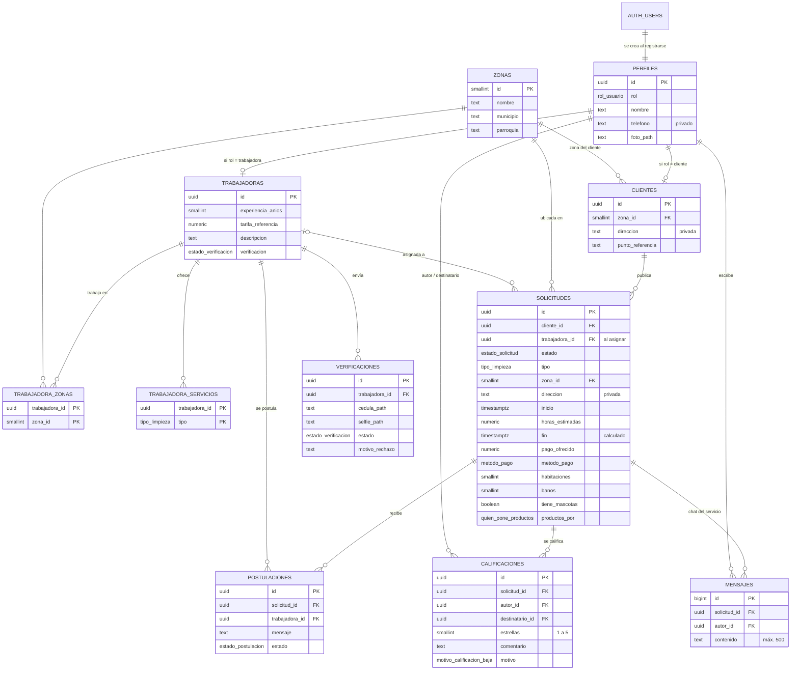

# Base de datos de LimpiaYa (HD-03)

La base vive en Supabase (Postgres). Todo cambio se hace con **migraciones** en `supabase/migrations/`, nunca a mano en el panel, para que los cuatro tengamos la misma base.

| Migración | Qué hace |
|---|---|
| `..._esquema_inicial.sql` | Tablas, tipos, índices y las zonas de Caracas |
| `..._seguridad_rls.sql` | Perfil automático al registrarse, `mi_sesion()`, permisos y políticas RLS |
| `..._vistas_publicas.sql` | Vistas con lo que un usuario puede ver de otros (sin datos privados) |
| `..._storage.sql` | Buckets de fotos: `avatars` (pública) y `verificaciones` (privada) |
| `..._zonas_parroquias.sql` | Agrega la parroquia a cada zona, para elegir Municipio → Parroquia → Urbanización |

## Diagrama entidad-relación

También está como imagen en [diagrama-er.png](diagrama-er.png) (es la que se adjunta a la tarjeta HD-03 en Trello).



Una **solicitud asignada es lo que las historias llaman "servicio"**: es la misma fila, que pasa por los estados `publicada → asignada → completada` (o `cancelada`).

## Qué historia usa cada tabla

| Tabla o vista | Historias |
|---|---|
| `perfiles`, `clientes`, `trabajadoras` | HU-01, HU-02A/B, HU-04, HU-05 |
| `zonas`, `trabajadora_zonas`, `trabajadora_servicios` | HU-04, HU-05, HU-11 |
| `solicitudes` | HU-07, HU-08, HU-09, HU-10, HU-15, HU-16, HU-17, HU-28, HU-43, HU-52 |
| `postulaciones` | HU-12, HU-13, HU-14, HU-26 |
| `calificaciones` | HU-29, HU-30 |
| `verificaciones` | HU-21, HU-33 |
| `mensajes` | HU-38 |
| Vista `solicitudes_publicas` | HU-11, HU-13, HU-45: solicitudes **sin dirección** |
| Vista `trabajadoras_publicas` | HU-06, HU-14: perfil con zonas, servicios y promedio, **sin teléfono** |
| Vista `resenas_publicas`, `reputacion` | HU-06, HU-29 c4: reseñas visibles y promedios |
| Vista `perfiles_publicos` | Nombre y foto de cualquier usuario |

## Reglas de seguridad (RLS)

- **Sin sesión no se lee nada** (HD-02, criterio 3).
- Cada quien lee y edita **solo sus propias filas**. El admin lee todo.
- **Nadie puede cambiarse el rol** ni marcarse verificada: esas columnas no se pueden escribir desde la app.
- **Nadie se registra como admin** (HD-06).
- La **dirección exacta** solo la ven el cliente y la trabajadora asignada. Las demás trabajadoras usan `solicitudes_publicas`.
- El **teléfono nunca** se muestra a la otra parte (decisión del equipo).
- Solo una trabajadora **verificada** se postula, y solo a solicitudes Publicadas, futuras y de sus zonas (HU-12).
- Solo se califica a la otra parte de un servicio **Completado**, una vez (HU-29, HU-30).
- El chat solo funciona entre las dos partes, mientras el servicio está Asignado y hasta 7 días después (HU-38).
- Las fotos van en `avatars/<id del usuario>/…` y `verificaciones/<id>/…`: cada quien solo sube a su carpeta, y las cédulas solo las ven su dueña y el admin.

## Cómo se usa desde Flutter (en la capa data)

```dart
// Registro (HU-01): el perfil se crea solo con estos datos
await supabase.auth.signUp(
  email: email,
  password: password,
  data: {'nombre': nombre, 'telefono': telefono, 'rol': 'cliente'}, // o 'trabajadora'
);

// Al iniciar sesión (HU-02A/B): rol, si el perfil está completo y la verificación
final sesion = await supabase.rpc('mi_sesion');
// → {id, rol, nombre, foto_path, perfil_completo, verificacion}

// Trabajadora: solicitudes de sus zonas, sin dirección (HU-11)
await supabase.from('solicitudes_publicas').select().eq('estado', 'publicada');
```

## Pendiente para HD-04 (dónde vive la lógica)

Los **cambios de estado** no se pueden hacer directo desde la app; HD-04 debe decidir cómo hacerlos. La propuesta es usar funciones en Postgres llamadas con `supabase.rpc(...)`:

- Elegir trabajadora (HU-15): `publicada → asignada`, la postulación aceptada y las demás como no seleccionadas.
- Cancelar (HU-10, HU-28), completar (HU-17) y el cierre automático a las 48 horas.
- Cruce de horarios al postularse o elegir (HU-12 c3, HU-15 c4).

> **HU-13 (Ver mis postulaciones):** mientras HD-04 no cambie los estados en la base, la app deduce el estado que se muestra con `EstadoPostulacion.resolver` (`domain/entities/estado_postulacion.dart`) usando la solicitud: cancelada → *Solicitud cancelada*; asignada a otra trabajadora → *No seleccionada*; asignada a ella → *Aceptada*. Lee `postulaciones` + las vistas `solicitudes_publicas` y `perfiles_publicos` (sin migración nueva ni dirección exacta). Cuando HD-04 actualice `postulaciones.estado`, la regla sigue siendo válida.

## Cuenta de administrador (HD-06)

1. En Supabase → **Authentication** → **Users** → **Add user** → **Create new user**
   (marcar **Auto Confirm User**).
2. En el **SQL Editor**:
   ```sql
   select public.hacer_admin('CORREO_DEL_ADMIN');
   ```
   La función está en la migración `20261027200000_cuenta_admin.sql` y no se
   puede llamar desde la app.

## Datos de prueba para las demos (HD-07)

`supabase/datos_de_prueba.sql` crea 3 clientes, 5 trabajadoras verificadas,
10 solicitudes en varias zonas (con postulaciones, una asignada y una
cancelada). Todas las cuentas terminan en `@demo.limpiaya.app`:

| Rol | Correos |
|---|---|
| Cliente | maria@, luis@, gabriela@ |
| Trabajadora | carmen@, yelitza@, marisol@, andreina@, josefina@ |

1. Abrir el archivo y cambiar la contraseña de la línea «CAMBIA AQUÍ»
   (no subirla al repositorio; se pasa al equipo por privado).
2. Pegarlo completo en el **SQL Editor** y darle a **Run**.

Se puede correr otra vez antes de cada review: borra las cuentas de prueba
anteriores y todo lo suyo, y lo vuelve a crear con fechas a partir de hoy.
No es una migración: no se aplica con `supabase db push`.

## Cómo agregar un cambio a la base

```bash
supabase migration new nombre_del_cambio   # crea un archivo .sql nuevo
# escribir el SQL en ese archivo
supabase db push                            # lo aplica en Supabase
```
Nunca edites una migración que ya se aplicó: crea una nueva.
